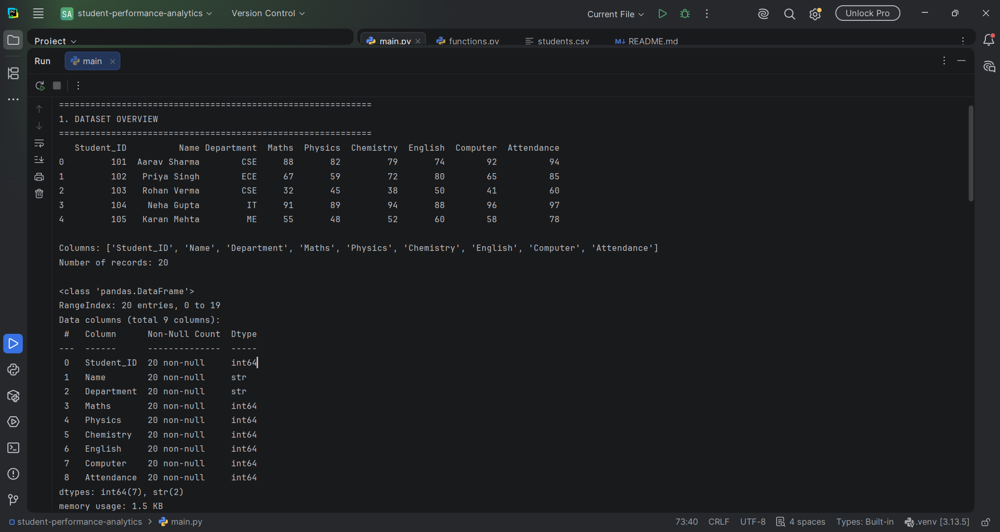
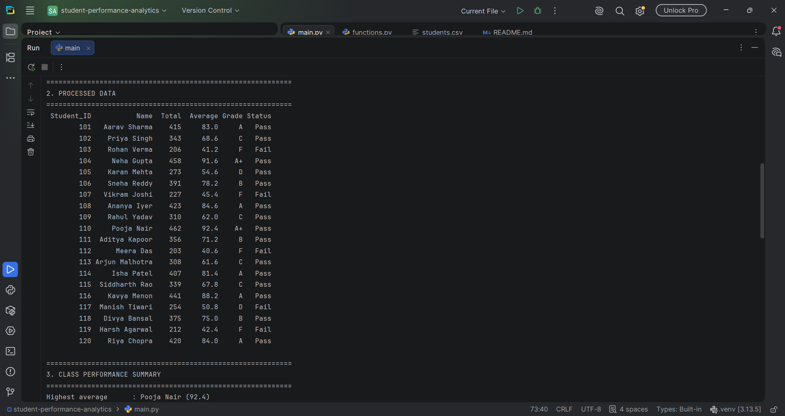
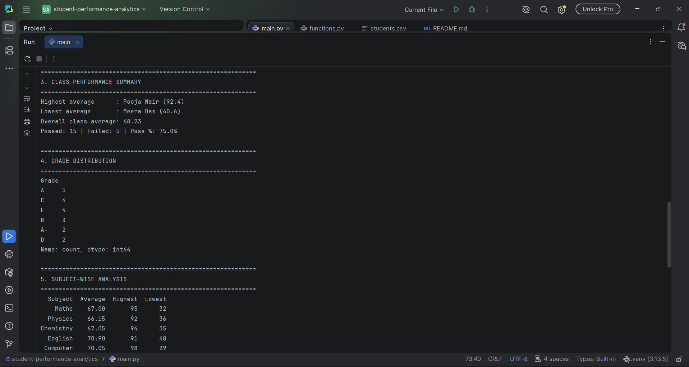
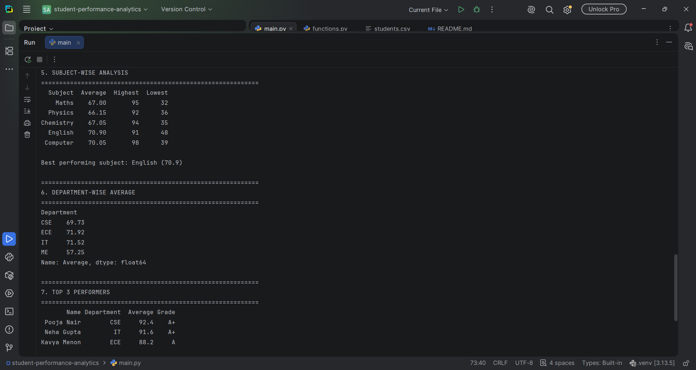
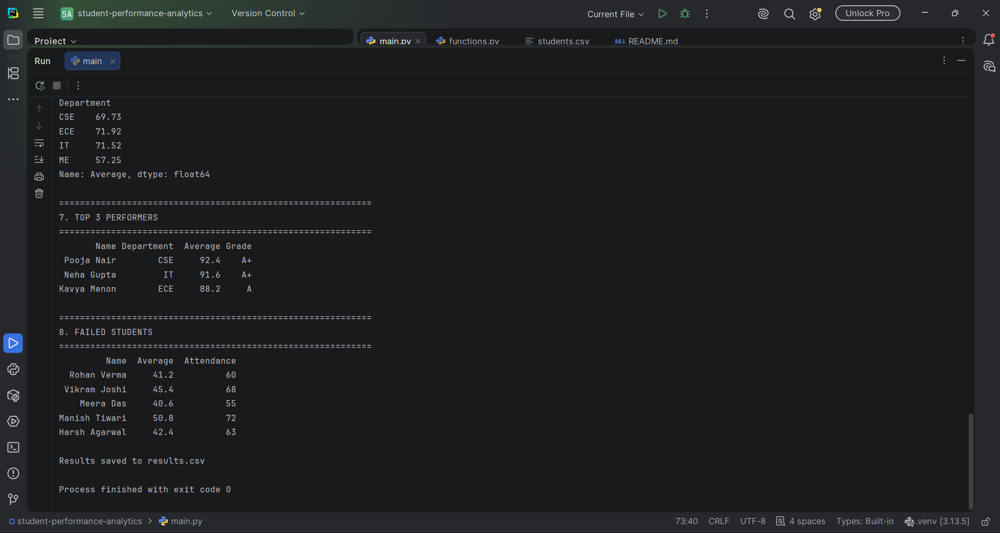

# Student Performance Analytics System

**Student Name:** Ragvendra Singh

**Course:** Python with AI, EWB Courses

**Submission Date:** 25 October 2026

---

## 1. Project Title
Student Performance Analytics System

## 2. Objective
Teachers often have student marks in spreadsheets and need to calculate totals, averages, grades and pass/fail results by hand. This project automates that work. It reads student records from a CSV file, processes them using NumPy and Pandas, and produces a clear report with grades, pass/fail statistics, subject-wise performance and top performers.

## 3. Technologies Used
- Python 3.13
- NumPy (numerical calculations)
- Pandas (DataFrame handling and analysis)
- PyCharm (IDE)
- Git and GitHub (version control and submission)

## 4. Dataset Description
- **File:** `students.csv`
- **Records:** 20 students
- **Columns:** Student_ID, Name, Department, Maths, Physics, Chemistry, English, Computer, Attendance
- **Departments:** CSE, ECE, IT, ME
- Marks are out of 100 and attendance is a percentage.

## 5. Implementation

1. **Loading data:** `load_data()` reads `students.csv` into a Pandas DataFrame. The program prints the first rows, the column names, the number of records and the data types.
2. **Total and average:** `calculate_total_and_average()` converts the subject marks to a NumPy array and uses `np.sum` and `np.mean` along each row to add the `Total` and `Average` columns.
3. **Grading:** `assign_grades()` loops through every average and calls `get_grade()` to assign a grade.

   | Average | Grade |
   |---|---|
   | 90 and above | A+ |
   | 80 to 89 | A |
   | 70 to 79 | B |
   | 60 to 69 | C |
   | 50 to 59 | D |
   | Below 50 | F |

4. **Pass/fail:** `assign_pass_fail()` uses `get_status()`. A student passes only if they score at least 40 in **every** subject **and** have attendance of at least 75%. Otherwise the student fails.
5. **Subject-wise analysis:** `subject_analysis()` loops over the five subjects and uses NumPy to find the average, highest and lowest marks of each.
6. **Department analysis:** `department_analysis()` uses `groupby` to find the average marks of each department.
7. **Top performers:** `top_performers()` sorts students by average in descending order and returns the top 3.
8. **Report:** `main.py` prints all results in 8 clearly headed sections and saves the processed data to `results.csv`.

## 6. Key Features
- `load_data()`: loads the CSV into a DataFrame
- `calculate_total_and_average()`: total and average marks using NumPy
- `get_grade()` and `assign_grades()`: grading using a loop
- `get_status()` and `assign_pass_fail()`: pass/fail rule based on marks and attendance
- `subject_analysis()`: subject-wise average, highest and lowest
- `department_analysis()`: department-wise average
- `top_performers()`: top 3 students
- Class summary: highest, lowest and overall average, number passed and failed, pass percentage and grade distribution

## 7. Output / Screenshots

**Dataset overview**



**Processed data (totals, averages, grades, status)**



**Class summary and grade distribution**



**Subject-wise and department-wise analysis**



**Top performers and failed students**



## 8. Final Outcome
The program ran successfully without errors and produced the complete analysis:
- **Highest average:** Pooja Nair (92.4)
- **Lowest average:** Meera Das (40.6)
- **Overall class average:** 68.23
- **Passed:** 15 students, **Failed:** 5 students, **Pass percentage:** 75%
- **Best performing subject:** English (average 70.9)
- **Top 3 performers:** Pooja Nair, Neha Gupta, Kavya Menon

The project achieved its goal of turning raw student data into a readable performance report using Python, NumPy and Pandas.

## 9. Challenges & Learning
- **Understanding `get_status()`:** At first I did not understand how a function receives one student at a time. I learned that `row` holds one student's data and that `.all()` checks every subject mark together with the attendance condition.
- **PyCharm type warnings:** PyCharm showed yellow warnings on `pd.read_csv()`. I learned these come from the type checker and are not real errors, since the program still ran with exit code 0.
- **Git setup:** The first commit failed with an "Author identity unknown" error. I fixed it by setting my name and email with `git config --global user.name` and `git config --global user.email`, then committed and pushed again.
- **Code organization:** I learned to keep reusable functions in `functions.py` and the report in `main.py`, which makes the code easier to read and test.

## 10. GitHub Repository
https://github.com/ragvendra398/student-performance-analytics

## How to Run
```bash
pip install numpy pandas
python main.py
```